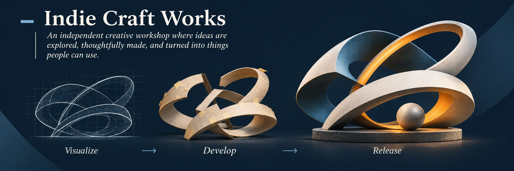

  

  <strong>Thoughtfully built. Always exploring.</strong>

  A little corner for things we make, ideas we chase, and experiments that sometimes turn into something useful.

---

## So, what's this about?

I like making things. Exploring ideas, solving little problems, trying unfamiliar approaches, and occasionally disappearing down engineering rabbit holes for much longer than expected.

**Indie Craft Works** is where I bring those interests to life.

Some ideas become actual products. Some stay as experiments. Others teach us something and quietly find their way into the archives. Each has its own little story and that's part of the fun.

## Things on the workbench

A few things we're making, tinkering with, or exploring.

| Project        | Description                | Status         |
| -------------- | -------------------------- | -------------- |
| **Unbothered** | Be social. Not measurable. | In development |

More things will find their way here as they take shape.

## A few things we believe in

- Make it useful before making it complicated.
- Care about the little details.
- Don't add features just because you can.
- Stay curious. Question assumptions.
- Experiment, break things, learn, and try again.
- It's okay if an idea doesn't become a product.

Nothing revolutionary here. Just a few things we try to keep in mind while making things.

## Say hello

Found something interesting? Have a suggestion? Just want to talk about something we've made?

Feel free to reach out.

- **GitHub:** [@indiecraftworks](https://github.com/indiecraftworks)
- **X:** [@its_akpatel](https://x.com/Its_AKPatel)
- **Email:** [indiecraftworks@gmail.com](mailto:indiecraftworks@gmail.com)

---

  Made with curiosity, patience, and occasional bouts of debugging.

